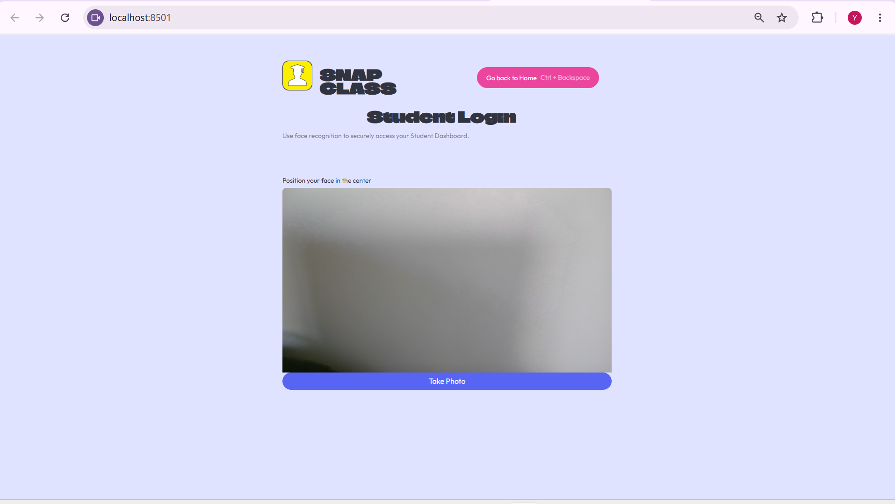
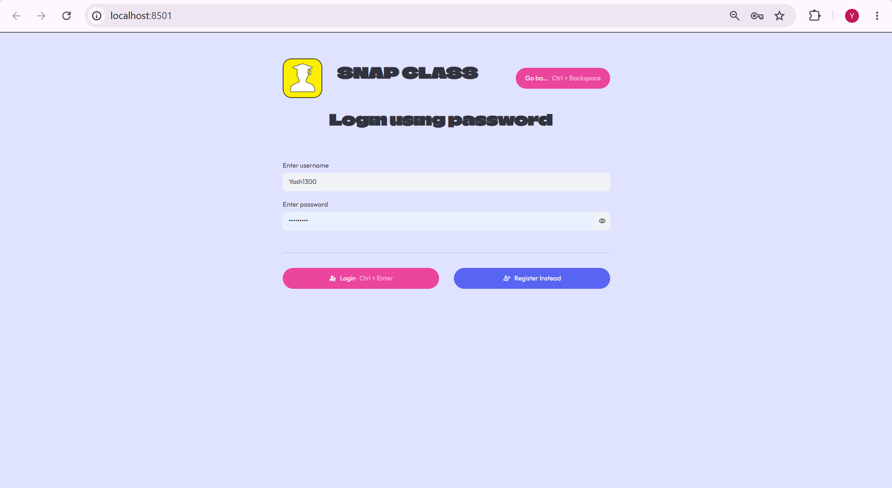
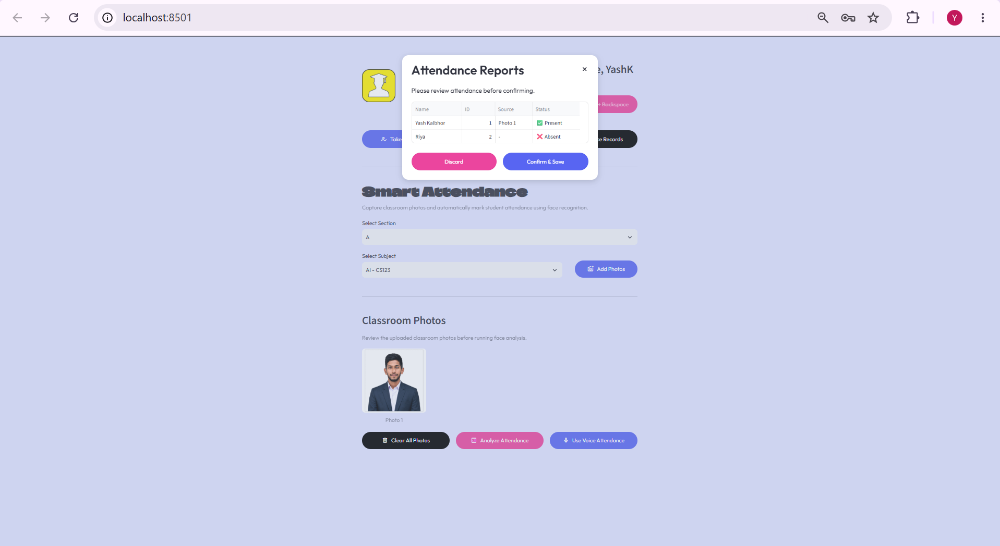
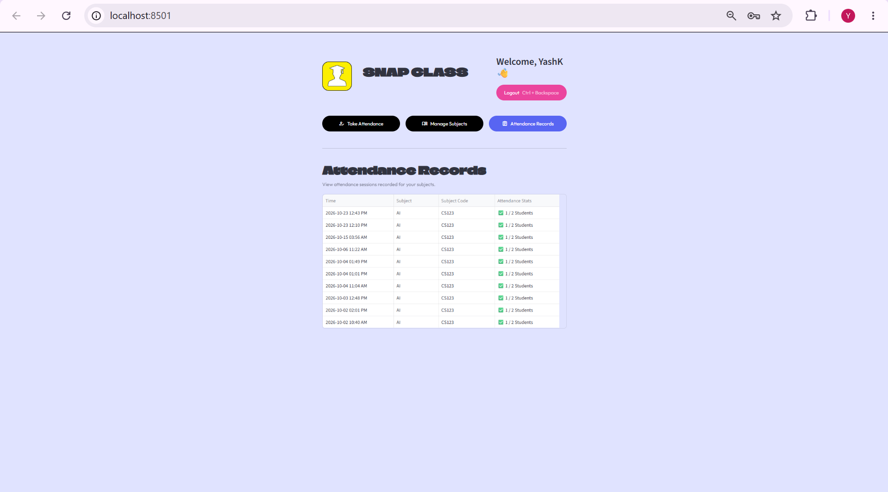

# SnapClass: AI-Based Attendance Management System

SnapClass is a face-recognition attendance application with separate **Student** and **Teacher** portals. A teacher uploads a classroom photo, the app identifies enrolled students, and the teacher reviews and confirms the result before attendance is saved.

**Live demo:** https://snapclass-student-attendance.streamlit.app/

---

## Screenshots

| Student Portal | Teacher Dashboard |
|---|---|
|  |  |

| Attendance Review | Attendance Records |
|---|---|
|  |  |

---

## Features

**Student**
- Face enrollment during registration
- Automatic identification of existing students through the camera
- Enrollment in subjects using a subject code
- Attendance history

**Teacher**
- Registration and login (passwords hashed with bcrypt)
- Create and manage subjects
- Share subject codes with students
- Classroom photo-based attendance using face recognition
- Review recognized students and confirm before saving
- Attendance records and session statistics

**Optional**
- Voice-based attendance using stored voice embeddings

---

## Tech Stack

| Area | Tools |
|---|---|
| Language | Python |
| Web interface | Streamlit |
| Computer vision | OpenCV, dlib, face_recognition, PIL |
| Data and ML | NumPy, Pandas, scikit-learn |
| Database | Supabase |
| Security | bcrypt, Streamlit secrets |
| Version control | Git, GitHub |

---

## How It Works

1. A student registers and enrolls a face. The face embedding is stored in Supabase.
2. A teacher creates a subject and shares its code. Students join the subject using that code.
3. The teacher uploads a classroom photo for a subject.
4. The app detects faces in the photo and compares them with the enrolled students' embeddings.
5. The teacher reviews the recognized students and confirms the list.
6. Confirmed attendance is saved to Supabase and appears in the records and statistics views.

---

## Project Structure

```
SnapClass-AI-Attendance/
├── app.py                 # Streamlit entry point
├── requirements.txt       # Python dependencies
├── .gitignore
└── src/
    ├── components/        # Reusable UI components
    ├── database/          # Supabase configuration and database functions
    ├── pipelines/         # Face (and optional voice) processing
    ├── screens/           # Student and teacher screens
    └── ui/                # Styling and layout
```

---

## Database

SnapClass uses Supabase to store:

- Teacher accounts
- Student profiles
- Face embeddings
- Voice embeddings (optional feature)
- Subjects
- Student-subject enrollments
- Attendance records

---

## Setup (Windows, Command Prompt)

**1. Clone the repository**

```
git clone https://github.com/yashkalbhor1300/SnapClass-AI-Attendance.git
cd SnapClass-AI-Attendance
```

**2. Create and activate a virtual environment**

```
python -m venv venv
venv\Scripts\activate
```

Python 3.11 was used during development.

**3. Install dependencies**

```
pip install -r requirements.txt
```

> `dlib` can be difficult to build on Windows. If installation fails, install the Visual Studio C++ Build Tools and CMake first, or use a pre-built `dlib` wheel that matches your Python version.

**4. Add your Supabase key**

Create the file `.streamlit/secrets.toml` in the project root. This file is listed in `.gitignore` and must never be committed.

```toml
SUPABASE_KEY = "your-supabase-anon-key"
```

The Supabase project URL is set in `src/database/config.py`. To run SnapClass with your own Supabase project, replace the URL there with your own and make sure the tables described in the Database section exist.

**5. Run the app**

```
streamlit run app.py
```

---

## Security Notes

- The Supabase key is stored in `.streamlit/secrets.toml` and excluded from Git.
- Use the Supabase **anon (public) key** for this app, never the `service_role` key.
- Teacher passwords are hashed with bcrypt.
- Face and voice data are biometric data. Anyone deploying this project for real use should get consent from users and follow applicable privacy rules.

---

## Limitations

- Recognition accuracy depends on photo quality, lighting, face angle, and camera resolution. No formal accuracy benchmark has been run yet.
- This is a personal project and has not been tested at large scale.
- The Student and Teacher dashboard layouts are still being made consistent.

---

## Author

   **Yash Kalbhor** | B.Tech CSE (AI & Analytics) | MIT ADT University, Pune

GitHub: https://github.com/yashkalbhor1300